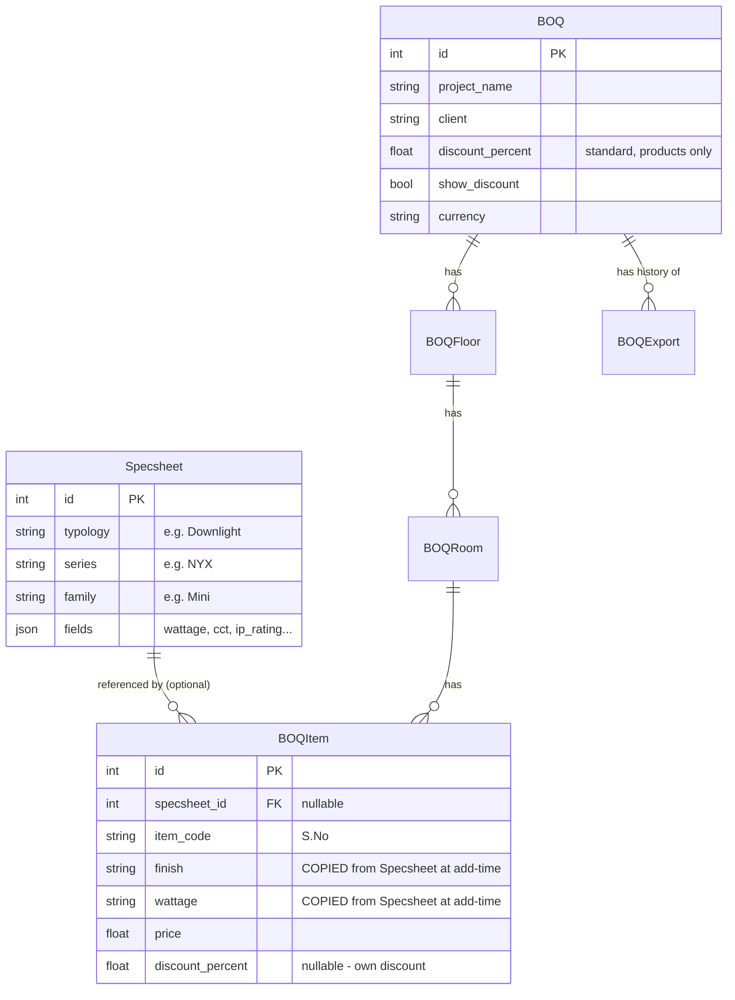

# Database Schema — A Guide for the Team

*Written for whoever inherits the backend of this tool with little or no prior context. If you already know SQLAlchemy/relational databases cold, skim the table reference (section 3) and jump to section 5, which is where your actual questions get answered.*

This document explains two things together, on purpose: **what the database actually looks like**, and **how to think about it** — because your two questions ("should I pre-load every product?" and "how does a messy batch upload actually get organized?") can't really be answered without understanding the shape of the data first. So read section 2 before you skip to section 5.

---

## 1. How to read this document

- Every table below is a **SQLAlchemy model** in `app/models.py` — that Python file is the actual source of truth; this document explains it in prose, but if the two ever disagree, trust the code.
- The database itself is **PostgreSQL** (or SQLite for local dev — see `deployment.md` section 3.2; the app runs on whichever `DATABASE_URL` points at, with zero code differences).
- "Column" and "field" are used interchangeably below — both mean one piece of data stored per row.
- Anywhere you see `id` referenced from another table (e.g. `boq_id`), that's a **foreign key** — a pointer to a specific row in another table, the same way a spreadsheet formula might reference another sheet's row number.

---

## 2. The big picture: three kinds of data

Before looking at individual tables, understand that this database holds three genuinely different *kinds* of information, and mixing up their roles is the single most common way a backend intern gets confused on a project like this:

| Kind | Tables | Analogy | Who changes it, and how often |
|---|---|---|---|
| **Catalog data** | `Specsheet` | A product library / warehouse catalog | Grows whenever someone uploads a new manufacturer PDF. Rarely edited once correct. |
| **Working data** | `BOQ`, `BOQFloor`, `BOQRoom`, `BOQItem`, `BOQExport` | A specific customer's shopping cart / order | Created and edited constantly — every BOQ a designer builds lives here. |
| **System data** | `User`, `ConfigRule`, `FieldCode` | Admin settings | Set up once, tweaked occasionally by an admin. |

The relationship between the first two is the crux of your whole question, so here it is as a diagram:

**The one sentence to remember from this whole document:** a `BOQItem` does **not** live-reference a `Specsheet` for its details — it **copies** the values it needs (finish, wattage, description, etc.) at the moment someone adds it to a BOQ. `specsheet_id` is kept only as a *pointer back* (so the app can re-open the Configurator on that row later, or fetch a product photo), not as the live source of truth for what's printed on the BOQ/Quotation. Section 4 explains why this matters a lot for your questions.

---

## 3. Table-by-table reference

### 3.1 `Specsheet` — the product catalog

One row = one product, extracted from one page of an uploaded manufacturer PDF.

| Column | Type | Meaning |
|---|---|---|
| `id` | int, PK | |
| `filename` | string | Original uploaded PDF's filename (see section 5.2 for why this barely matters) |
| `category` | string | The literal product-type text printed on that PDF page's own title block (e.g. "Recessed LED Downlight –Adjustable"). Descriptive, not a grouping key. |
| `typology` | string | The **business classification** — "Downlight," "Track Light," etc. This is what Config Rules and the Configurator are scoped to. Auto-guessed from `category` on upload; blank ("Unclassified") if the guess isn't confident. |
| `product_name` | string | e.g. "NYX -Mini" — this exact page's product |
| `series` | string | e.g. "NYX" — the product line, shared across sizes |
| `family` | string | e.g. "Mini," "Midi" — the size within a series |
| `variant` | string | e.g. "With Trim" vs "Trimless" — distinguishes otherwise-identical pages |
| `environment` | JSON (list) | Subset of `["Interior", "Exterior"]` — **not exclusive**: a product can legitimately be both, so this is a small list, not a single value like `typology`. Auto-guessed from `category` text (`app/environment_classifier.py`) only when it explicitly says so ("underwater," "inground," "outdoor," ...); `[]` means unclassified. Since most Interior-context PDFs never say "interior" in their own text, expect this to need far more manual tagging than `typology` does. |
| `page_number` | int | Which page of the source PDF this came from (a catalog PDF has many pages, one product each) |
| `make` | string | Manufacturer/brand |
| `source_pdf_path` | string | Where the original PDF sits on disk (`data/uploads/...`) |
| `image_path`, `diagrams` | string, JSON | Product photos/diagrams extracted from the PDF |
| `raw_text` | text | Everything `pdfplumber` extracted from that page, unprocessed. Used for duplicate detection. |
| `params` | JSON | Every parsed key/value, grouped by section, exactly as the PDF laid it out (e.g. `{"MECHANICAL PARAMETERS": {"FINISH": "BLACK", ...}}`) |
| `fields` | JSON | The **flattened, canonical** version of `params` — `wattage`, `cct`, `ip_rating`, `beam_angle`, `control`, `material`, `mounting`, etc. This is what the Library cards, Configurator, and Config Rules actually read. |
| `options` | JSON | Same keys as `fields`, but split into a list where the PDF listed several ("10°/ 15°/ 25°" → `["10°", "15°", "25°"]`) |

**Nothing in this table ever references a BOQ.** A Specsheet has no idea how many BOQs use it, or which ones. That's deliberate — see section 4.

### 3.2 `BOQ` — one quotation/BOQ project

| Column | Type | Meaning |
|---|---|---|
| `id` | int, PK | |
| `project_name`, `project_code`, `area`, `client`, `kind_attention` | string | Cover-sheet details. `project_code` (added 2026-08-06) is the studio's own project reference (e.g. "CRA-2026-014") - distinct from `project_name` (the human-readable title) and from `BOQItem.item_code` (a per-line S.No within one BOQ) - genuinely optional, shown on every export's cover page |
| `boq_date` | string (ISO date) | |
| `notes_text` | text | Editable terms/closing text for the NOTE page — blank means "use the studio default" |
| `discount_percent` | float | The quotation's **standard** discount. Every *product* line is quoted at it unless the line has its own (`BOQItem.discount_percent`); accessories, drivers and power supplies are not discounted by it (since 2026-09-29). The rule lives in one function, `app/quotation_export.line_discount`. |
| `show_discount` | bool, default true | Whether the exported quotation shows the discount (Discounted Price column, Disc. % column on every line, Discount row). The only thing that decides it (since 2026-10-01): true shows it even when every rate is 0%; false quotes final prices only - same totals, no discount wording anywhere. Added by `scripts/migrations/migrate_line_discounts.py`. |
| `currency` | string | `"INR"`, `"USD"`, `"EUR"`, or `"GBP"` — one currency for the whole document |
| `created_at`, `updated_at` | datetime | |

A `BOQ` owns a tree: `BOQ` → `BOQFloor` → `BOQRoom` → `BOQItem`. "Floor" and "Room" are free text, not fixed building floors — a BOQ might use "Ceiling"/"Floor" as its two "floors" (matching how the real sample Quotation groups by mounting type, not literal building storeys).

### 3.3 `BOQFloor` / `BOQRoom`

Just a name, a sort order, and a foreign key up to their parent. `BOQRoom` additionally has a `remark` (text) — one free-text note for the whole room, shown as a single row on export rather than per-item.

### 3.4 `BOQItem` — one line on a BOQ/Quotation

This is the table your questions actually revolve around.

| Column | Type | Meaning |
|---|---|---|
| `id` | int, PK | |
| `room_id` | int, FK → `BOQRoom` | required |
| `specsheet_id` | int, FK → `Specsheet`, **nullable** | Which catalog product this came from — `NULL` if it's a hand-typed blank/accessory row with no catalog entry at all |
| `item_code` | string | This studio's own project numbering (e.g. "CRA2.2") — shown as "S.No" |
| `reference_number` | string | A separate reference code, shown as "REF NO." on the Quotation |
| `model_no` | string | The manufacturer's own SKU (e.g. "LL 102234") |
| `description`, `finish`, `wattage`, `beam`, `control`, `led_color`, `make` | string/text | **Copied** from the Specsheet at the moment this row was created (see section 4) |
| `qty`, `unit` | string | |
| `remarks` | string | |
| `is_accessory` | bool | Accessory/driver row vs. a real product row — changes how it's grouped/labelled on export |
| `price` | float | Unit price — manually entered, defaults to 0 |
| `discount_percent` | float, **nullable** | This line's own discount, 0-100. `NULL` (the usual case) follows the quotation's rule; a number overrides it, `0` included (a product left out of the discount). Added 2026-09-29 by `scripts/migrations/migrate_line_discounts.py`. |

### 3.5 `BOQExport`

A simple audit log: every time someone exports a BOQ (any of the 4 formats), one row gets added recording the file path and timestamp. Nothing reads this for anything functional today — it exists so "what got exported and when" is answerable later.

### 3.6 `ConfigRule` / `FieldCode` — admin-configured rules

`ConfigRule`: "if wattage=24W, hide beam angles X/Y/Z" — scoped to a `typology`, evaluated live while someone's adding a product via the Configurator, so they can't accidentally pick a combination that doesn't really exist.

`FieldCode`: a lookup table mapping a field value (e.g. `finish="WHITE"`) to a short code (`"WH"`) used to build the auto-generated product-code suggestion. Global, not per-typology.

`FieldCode` rows are edited on the Nomenclature tab (offered with the `config.edit` permission; a
change also needs `npd.edit`). `ConfigRule` rows have had no screen since the Config Rules tab was
removed on 2026-09-28: every rule in use is an Exenia coupling written by
`scripts/catalogues/build_exenia_config_rules.py`, and the Configurator still applies them.

**Identity codes live here too (2026-09-22).** The segments that *name* a product - `series`,
`family`, `sub_typology`, `variant`, and any field a typology adds under the `IDENTITY` group of
`parameter_templates` - are `FieldCode` rows like any other (`field="family", option_value="Midi",
code="M"`). They are set from the NPD form's Identity step through `POST /api/npd/identity-code`,
which accepts identity fields only, so an NPD author (`npd.edit`) can name the abbreviation of the
series they just invented without holding permission over the rest of this table. The generated
product code puts the identity segments first, then the configured options.

`parameter_templates.group_name = "IDENTITY"` marks a template row as an identity field rather
than a specification: its value is stored in `specsheets.fields[field_key]` and
`specsheets.params["IDENTITY"]` exactly as a parameter is, but the generated specsheet prints it
in the name bar and never among the parameter groups (`app/npd.py`: `identity_bits`,
`ordered_groups`). No new table or column was needed.

### 3.6a `CodeAttribute` / `CodeScheme` — the studio's product code (2026-09-25)

A product code is the address of one SKU - one configured product: `DL-RC-CRV-AD-MC-WT-LR-7W-27K-CRI95-15D-WH-MW-IP20`.
Everything that decides it is data, edited in **NPD -> Product codes** (`npd.edit`), so a new
axis or a changed abbreviation never needs a developer. `app/product_codes.py` is the only place
a code is assembled; the NPD form, the Configurator, the BOQ description and Match all ask it.

`code_attributes` - one thing a code can say about a product:

| Column | What |
|---|---|
| `key` | Where the value lives: a column (`typology`, `series`, `family`, `variant`) or a key of `specsheets.fields` (`trim_details`, `aperture_shape`, ...). Unique per discipline. |
| `label` | What people call it ("Trim"). |
| `part` | `identity` (names the product) or `config` (configures it). Either can be a choice: where a product keeps an option list for the attribute - which NPD does only for a parameter it marks as a choice, and which the Configurator asks - each option is a SKU of its own and the code carries the one chosen (a wall grazer's fixed or adjustable bracket). |
| `rule` | How a value with no abbreviation becomes a code: `list` (abbreviations only), `number` (14.4W -> 14P4), `numbers` (18°X20° -> 18X20), `kelvin` (3000K -> 30), `digits`, `text`. |
| `prefix`, `suffix` | Letters written around what the rule produces, so a number says what it measures: wattage `W` (7W), CCT `K` (27K), CRI `CRI` (CRI95), beam `D` (15D), IP `IP` (IP20), length `L` (L1000), driver IP `DIP` (DIP67). Added by `scripts/migrations/migrate_code_attribute_affixes.py`. A typed abbreviation is used as it is. |
| `multi` | Zero or many values at once, each adding its own code (accessories). |
| `note`, `sort_order` | Shown in the panel. |

`code_schemes` - the shape of one brand's code for one typology:

| Column | What |
|---|---|
| `make`, `typology` | Whose code this is. `typology = ""` is the brand's default, used by any typology without a scheme of its own. |
| `prefix`, `separator` | Letters in front (none for InHouse today) and what goes between segments (`-`). |
| `segments` | `[{"key", "include", "optional"}]` in code order. `include` false keeps the segment in the structure but out of the code; `optional` skips it for a product that records no value instead of calling that code incomplete. A list on the row, because its order *is* the grammar and it is always saved whole. |
| `retired_at` | Set when **Use brand default** puts the typology back on the brand default. The row is kept, not deleted, so **Restore its own structure** can bring it back exactly as it was; while set, the row codes nothing. NULL means in use. One row per brand and typology either way: saving a new structure for the typology reuses (and replaces) a retired one. Added by `scripts/migrations/migrate_code_scheme_retired.py`. |

The abbreviation for each value is a `FieldCode` row keyed by the attribute's `key` - the same
table as above, matched ignoring case, spacing and the en dash (`app/product_codes.norm`). A typed
abbreviation always wins over the attribute's rule.

A brand with no scheme keeps the codes it had before (the manufacturer's own, or the older
generated `LL-` code). Where a scheme applies, `build_description` puts **its** code on the description's
`Product Code:` line - only once every segment is settled, never a partial one.

**A code says only what the product states.** A segment reads the product's own value, or the
option chosen from the ones it offers. A product with no value for a segment leaves it out
(`optional`) or shows it missing - nothing is filled in with what is usual. A value that lists
several options the product does not offer as a choice ("IP20 / IP67" on a driver) is not coded
as either (`reason: "several"`), unless somebody typed an abbreviation for the whole value.

**One SKU, one code.** `product_codes.configurations()` lists every combination of the options a
product offers with the code each gets, and `sku_audit()` checks that every one has a code and no
two share one. `GET /api/npd/codes` returns, per product, `skus`, `uncoded`, `complete` and the
segments `missing`, and `duplicates` - one entry per set of products whose configurations share
codes, with an example `code` and the `count`. The NPD form's preview reports `shared_with` the
same way, by configuration.

**Every segment says what it is.** A code of digits alone - typed, or produced by a rule with no
prefix or suffix - counts as missing (`product_codes.explicit`), and the abbreviation endpoint
refuses one. Where a value has no code, the API returns a suggestion (`suggest_code`: initials,
the first three letters of one word, or the attribute's initials before a bare number - series
variant 1 is SV1), which the panel offers but never stores unasked.

New keys on InHouse `specsheets.fields`, written by
`scripts/backfills/structure_inhouse_catalogue.py` - each only where the product states it:
`form` (track lights, from the series), `series_variant` (InHouse's own designation, as written
after the series: `S 10 12`, `1010BH TV`, `PIN`, `DIFFUSED`, `RGBW PIXEL`), `aperture_shape`
(`Square` only - no product states Round), `lamp_count` (`Dual` only, shown as Heads),
`supply_voltage` (`24V DC` / `48V DC`, from the variant), and `name_line` - the specsheet's name
bar held as written, where the split series would otherwise print less (`npd.identity_bits`
prints it as is). None of these are template parameters, so none of them print, and the run
checks every product's printed output is unchanged. Length is not a new key - GLANCE and PULSE
already carry `luminaire_length` ("1000 mm"), which the code reads as L1000. `colour_system` and
`profile_size`, which the first version of that script inferred, were removed on 2026-09-25 with
their attributes.

### 3.6b `VendorOrderCode` / `VendorCodePart` / `VendorCodeRule` — a manufacturer's own order codes (2026-10-19)

DuraGreen prints its own order codes in its spec sheets (`AFL5706W-AL-30N120`), and those are
what a DuraGreen BOQ line carries - not a studio code. They are kept apart from `field_codes` /
`code_attributes` / `code_schemes` on purpose: the studio's abbreviation table holds one code per
value for every brand, but DuraGreen gives the same finish different letters in different ranges
(Polished Chrome is `PC` in ACME, `L` in MOOD), so its letters could not live there without
changing InHouse codes. Created by `scripts/migrations/migrate_vendor_order_codes.py`; filled by
`scripts/backfills/backfill_duragreen_npd.py` and `scripts/backfills/backfill_duragreen_code_rules.py`; edited in **NPD → DuraGreen**; read by
`app/duragreen.py`, the only place a DuraGreen code is found.

`vendor_order_codes` - one code exactly as printed:

| Column | What |
|---|---|
| `make`, `specsheet_id` | Whose code, and which product it belongs to (cascade-deleted with the product). |
| `code` | As printed. |
| `config` | The configuration it orders, in the app's own field names and values: `{"wattage": "6W", "beam_angle": "120°", "cct": "3000K", "control": "On/off"}`. A code part the product names no option for is stored as `"?30"`, which can never match a choice. A product printed in a mains and a 24V DC version also has `"voltage"` (`"AC 220-240V"` / `"24VDC"`, the 24V codes ending `-24`), and one whose sheet labels each table (`"Recessed Trim"`, `"Surface"`) has `"mounting"` in the sheet's words - each the choice of which printed version a BOQ line gets (`duragreen.SELECTORS`), and one whose sheet prints several fittings nothing else tells apart has `"version"` (`"RTC23 - mini-trim contour"`, `"SA36/SB - Standard Base"`), set by the code-rules backfill's `offer_versions` and listed in the product's options. A code typed in NPD can name any configuration field (a track's `length` and `finish` too). |
| `printed` | The rest of the table row as printed: lumens (one column per CRI where the table gives two), efficacy, optics, length. `cct_from_code` when the table prints rows alike and the CCT was named from the code's last piece (neon strips: `-27`, `-30` ...); `note` on a code typed in NPD - where the person got it ("DuraGreen email, 22 Oct"). |
| `parts` | The code cut into named pieces in order, separators included, joining back into `code` exactly: `[["type","AFL"],["size","57"],["wattage","06W"],["sep","-"],["variant","AL"],...]`. Empty for a code that could not be cut up; it is then only ever used whole. |
| `source`, `sort_order` | The spec sheet's file name (or `entered by <email>` for one typed in NPD, or `2026 General Catalogue p.N` for a code its catalogue page prints), and the table's own order. |

One row per linked product is the catalogue page's **worked example**, kept as the code's template, not as a code to order: its `source` ends in `(code example)`, its `config` is empty, and `printed` holds `legend` (`[[field, code, meaning], ...]` as the page decodes it), `page` (the printed folio), `pdf_page` (the PDF page, 23 more - the one that decides the product's range), `skipped` - pieces the legend lists that the example leaves out (p.210 drops the `TL` its own table has) - and, for a numbered sibling, `adapted` (`{"style": [page's, own], "page_example": ...}`: Sparkle 35-1's template is p.452's `-5` example with its own `1`). `app/duragreen.py` takes only the **finish** (the part after the beam) from it, and uses it as the whole pattern only for a product with no printed code and nothing skipped.

`vendor_code_parts` - what one option of one product adds to its code (`3000K` → `30`):

| Column | What |
|---|---|
| `attribute`, `value`, `code` | The field (`cct`, `control`, `beam_angle`, `wattage`, finishes ...), the option as the product lists it, and its code. |
| `status` | `stated` - the product's own sheet prints it. (`range` and `matched` rows, taken on 19 Oct from the code matrix printed on the spec sheets, were removed by `backfill_duragreen_code_rules.py`: that matrix is older than the 2026 catalogue and disagrees with it - phase cut `M` against `P`, `AB` Antique Bronze against Antique Brass. The removed rows are listed in `Duragreen Catalogue/code_parts_removed.csv`.) |
| `source`, `note` | Where it came from (`order_codes`, `code_legend`, `entered by ...`), and why. |

`vendor_code_rules` - DuraGreen's code tables, as its 2026 General Catalogue prints them. Rebuilt from the catalogue on every run of `scripts/backfills/backfill_duragreen_code_rules.py` - except a row whose `source` starts `entered by`: a letter a person added in Nomenclature from DuraGreen's answer, or the letters of a structure made in NPD (scope = its name), which a reload never deletes (2026-10-27):

| Column | What |
|---|---|
| `make`, `scope` | Whose rules; `ACME` (the table on catalogue p.33 - the ACME downlights' rule, PDF pp.57-223), `MOOD` (p.222, PDF pp.246-289), `EVOLINE` (its only table, in the ACME public price list p.127 - EVOLINE pages PDF 226-241, 394-395, 434-435, 534-541, 546-547), `BELLA 41` / `GLAMO 68` / `ARTFOCUS 36` (their price-list tables, 26 Oct), the earlier ACME editions `ACME 2025` / `CHOSEN ONES 2025` / `ACME 2024` (read only for a meaning the 2026 ACME table does not list - see `duragreen.EARLIER_EDITIONS`), or `LEGEND` (one product page's decoded example). A product outside both sections follows its own sheet and page; a piece from either table is only ever unconfirmed for it. |
| `segment`, `attribute`, `position`, `dash_after` | The table's column heading (`Colour Temp`), the app field it codes (`cct`), its place in the code, and whether a `-` follows it. |
| `meaning`, `code` | One entry: `2700K-6000K` -> `2760`, `Phase Cut` -> `P`. |
| `source` | The catalogue page it was read from. |

`vendor_code_structures` (2026-10-27) - a naming structure a person made in Nomenclature, for codes
no printed table holds: `make`, `name` (unique per make; never a DuraGreen table's name), `description`,
`segments` (JSON, in order: `[{"segment": "Type", "attribute": "type", "dash_after": false}]`),
`created_by`. Its letters are `vendor_code_rules` rows with `scope` = its name and `position` = the
segment's place. Created by `scripts/migrations/migrate_vendor_naming.py`.

`vendor_product_naming` (2026-10-27) - which structure one product is coded by, set by a person, one
row per product at most (`specsheet_id` unique, cascades with the product): `structure` (a printed
table's scope or a made structure's name) and `segments` (JSON, per attribute: `{"mode": "fixed",
"value": "Adjustable"}`, `{"mode": "quoted"}` or `{"mode": "out"}`). Only for a product no catalogue
page names; its codes are then built by `duragreen.structure_code`. See TUTORIAL 8.2.6.

A configured line's code is built the way the catalogue builds it, and labelled by its least
sure piece: **printed** (the whole code is printed - or typed in NPD - for exactly this
configuration), **composed** (every piece is printed for this product), **catalogue** (a piece is
from its own range's table), **pattern** (a CCT or beam written the way the product's own printed
codes write the ones they print), **general** (a piece is from elsewhere in its own range), **unconfirmed**
(a piece is printed nowhere for this product or its range: another range's table or page, or
DuraGreen's pattern). Where the ACME and MOOD tables disagree for a product outside both, or two
codes are printed for one configuration, there is no code, and the reason says why.
Two guards came from checking every printed code: a row must state each option the product offers
a choice of, and a product whose sheet prints codes for several versions (RTC and TLC, with and
without `/SB`) gets none until a person removes the other versions' codes - see TUTORIAL 8.2.1.
Which rules a product follows (its range's, or its own page's and sheet's) is `duragreen.scheme_of`
- see TUTORIAL 8.2.5.

**Tracks** (`scripts/backfills/backfill_duragreen_tracks.py`, from
`scripts/catalogues/read_duragreen_track_sheets.py`) are coded differently: their sheets print every
part's code in full, so each code is a `vendor_order_codes` row with no `parts`, and a line takes
the row its configuration names. A track's `config` is `{"length": "3m", "finish": "White"}`
(MINI-LINE 22: `{"length": "2000 mm"}`, the same code at every length); a feed's is `{"finish",
"polarity_groove"}`, the groove side read from the red line of the sheet's icon ("Groove on the
straight side, branch left (as drawn)"). Each feed, connector and end cap is its own `specsheets` row
(family = its system, e.g. `TRACK 1L`), and `params["TRACK SYSTEM"]` says which system it belongs to
and which catalogue page prints it. `length` and `polarity_groove` are DuraGreen configuration fields
(`duragreen.CONFIG_FIELDS`).

DuraGreen products also use `specsheets.base_price` / `price_adders`, as NPD products do -
`npd.priced_by_rule()` says which products are priced that way.

### 3.6c `ConfiguratorField` — what the Configurator asks, decided in NPD (2026-10-21)

Table `configurator_fields`: one row per detail the Configurator asks for one brand's typology, in
`sort_order`. Set in NPD ("Configurator questions"), read by `app/configurator.py`, which both the
Configure tab (`POST /api/typologies/resolve-options`) and the product form
(`GET /api/specsheets/{id}` → `configurator`) take their list from.

| Column | Meaning |
|---|---|
| `discipline`, `make`, `typology` | Whose list it is: `InHouse` / `Downlight`. |
| `field_key` | The key the value is stored under in `specsheets.fields` / `options` (`cri`, `beam_angle`, `reflector_finish`, `ugr` ...). |
| `label` | The Configurator's name for it, when the NPD parameter's own name reads badly there ("ACTUAL POWER" → "Wattage"). NULL: the NPD name. |
| `sort_order` | The order asked. |
| `updated_by`, `created_at` | Who saved the list, and when. The list is saved whole, so every row of it carries the same. |

No rows for a `(make, typology)` means nobody has decided, and the Configurator keeps its automatic
list (the ten `config_rules.FIELD_ORDER` details the products hold, then their other choices). A detail
some product of the typology offers a choice of is always asked: a saved list that leaves one out has
it put back at the end. Values are read by `config_rules.stated_values` (a product's choices, or the
one value it states). Created by `scripts/migrations/migrate_configurator_fields.py`, which also adds a
column the app may have created the table without.

### 3.7 `User`

Login accounts. `role` is `"admin"` or `"member"` — admin can edit Config Rules/Field Codes (since those affect every BOQ built afterward); everyone else can do everything else.

Two ways a row here gets created:
- **Google Sign-In** (`app/google_auth.py`, once `GOOGLE_CLIENT_ID`/`GOOGLE_CLIENT_SECRET` are set — see `GoogleAuthSetup.md`) — the normal path. The first successful sign-in from a given `@example.com` Google account auto-creates a row for it as `role="member"`, `password_hash=""`. Domain restriction is enforced in application code (`is_allowed_email()`), checking both the email's domain suffix *and* Google's own `email_verified` claim — not left to Google Cloud Console settings alone.
- **`python create_user.py`** — the fallback: works whenever Google Sign-In isn't configured yet (nothing else can log in until it's set up), and stays useful afterward purely for promoting/demoting a role (`password_hash` becomes irrelevant once Google Sign-In is active for a given account — `verify_password()` just always returns `False` against an empty stored hash, it doesn't error).

`password_hash` is a plain `String`, not nullable — a Google-provisioned account stores `""` rather than `NULL` here, specifically so no schema migration was needed to add this feature (an empty string is still a valid non-null value).

---

## 4. Why `BOQItem` copies data instead of referencing it live

This is the design decision that actually answers most of what you're asking, so it's worth slowing down on.

Imagine the *opposite* design: a `BOQItem` just stores `specsheet_id`, and every time you export a BOQ, the app looks up the current `finish`/`wattage`/etc. straight from the `Specsheet` row. Sounds elegant. It's also a trap:

- **A specsheet gets corrected months later** (someone notices the IP rating was mis-parsed and fixes it) → every BOQ ever built with that product silently changes too, including ones already sent to a client and possibly already invoiced. That's not a hypothetical bug, that's how live-reference designs actually fail in the real world.
- **A specsheet gets deleted** (discontinued product, or just cleaning up a bad upload) → every BOQ that used it would have a hole where the data used to be.
- **A BOQ needs to remain exactly what was quoted**, even if the catalog entry evolves. A quotation is a snapshot in time, not a live view.

So the actual design: adding a product to a BOQ **copies** the relevant fields onto the `BOQItem` row right then. `specsheet_id` is kept purely so the app can jump back into the Configurator pre-filled with "what this row currently has" if someone wants to *reconfigure* it later (see the Configurator's "Use Configurator" flow) — but that's an explicit user action, not something that happens automatically when the Specsheet changes.

**Consequence you need to understand**: deleting a `Specsheet` never breaks existing BOQs. The delete endpoint explicitly says so ("BOQ items already using it are kept as-is"). This is *why* you don't need to be precious about getting every catalog entry perfect before anyone starts using the tool — a correction later doesn't retroactively break anything that's already been built.

---

## 5. Your actual questions, answered

### 5.1 "Do I need a complete database of all products first, or hand over the tool with what's there and let the team add specs as needed?"

**Hand it over now, with whatever's already in the library.** Here's the actual reasoning, not just the recommendation:

1. **You said it yourself: there's no existing structured database of all products.** That means "build the complete database first" isn't actually a task with a defined finish line — it's "first, go create the very thing that doesn't exist yet, from scratch, by hand, before anyone's allowed to use the tool." That's a huge, open-ended project sitting *in front of* the tool actually being useful, and it delays the entire point of building this (saving the design team time) for a goal that may take months and still never feel "done" — product catalogs keep growing.

2. **The tool was built for exactly this incremental situation.** Uploading is self-service and cheap: select PDFs, the tool parses them, classifies them, and checks for duplicates automatically (see 5.2). There's no "batch import ceremony" that only an admin can run — any team member can add a missing product in the same couple of minutes it'd take you to add it on their behalf. The cost of "the product isn't in the library yet" is small and one-time, not a blocker.

3. **Section 4 is what makes this actually safe**, not just convenient: because a `BOQItem` copies its data at add-time, a library that's imperfect or incomplete on day one doesn't create a ticking time bomb. Correcting a Specsheet later (fixing a wrong typology, adding a missing field) never rewrites BOQs that already used it. You're not committing to "this data must be perfect forever" — you're allowed to improve the library over time.

4. **Practical middle ground, not either extreme**: before handover, it's worth spending a little time — not building a complete catalog, but making sure the *specsheets already uploaded* are correctly classified (no "Unclassified" pile-up) and that the manufacturers/product lines the team uses *most often* are in there. Use the Library tab's new classification chips (typology counts) to see this at a glance — if "Unclassified: 7" is sitting there, that's 10 minutes of clicking "Use with Caution: Edit" and picking the right typology for each, not a big project.

5. **What the team needs to know, explicitly, before handover**: "if the product you need isn't in the Library yet, upload its datasheet PDF — it takes a minute, and you don't need to ask anyone first." Make sure at least one non-technical team member has actually done this once before you hand over, so it doesn't feel like a mysterious backend task.

### 5.2 "If someone uploads 20-30 products from different files/folders/naming, how does the tool organize them into the working database?"

Short version: **filenames and folder structure are completely irrelevant.** The tool classifies everything from what's actually printed on the PDF page, not from what the file is called or where it came from. Here's exactly what happens, end to end:

1. **Upload**: on the Library tab, the "Upload specsheet(s)" button accepts multiple files at once — select all 20-30 PDFs in one go, regardless of what they're named or which folders they were sitting in on someone's laptop. There's no expectation that files are organized or named consistently beforehand.

2. **Parsing, per page, not per file**: each uploaded PDF is opened and *every page* is parsed as its own potential product (`app/pdf_parser.py`). This matters because manufacturer PDFs come in two shapes:
   - A single-page datasheet → yields exactly one product.
   - A multi-page **catalog** PDF (e.g. one PDF containing "NYX -Mini With Trim," "NYX -Mini Trimless," "NYX -Midi With Trim" as separate pages) → yields one product *per page*, each with its own extracted diagrams — nothing gets silently merged or only-the-first-page-kept.

   So "20-30 files" could easily become 40, 60, 100+ actual catalog entries, and that's expected, not a bug.

3. **What gets extracted from each page, automatically**: product name, category text, a technical parameter table (wattage, CCT, IP rating, beam angle, control, material, mounting, warranty, etc. — whatever the PDF's own tables contain), and any product photos/diagrams on that page. `series`/`family`/`variant` get split out of the product name using a size-word heuristic (e.g. "NYX -Mini" → series `"NYX"`, family `"Mini"`).

4. **Typology gets auto-assigned by keyword match** against the extracted category text (`app/typology_classifier.py`) — "downlight" anywhere in the text → typology `"Downlight"`, etc. If nothing matches confidently, it's left blank ("Unclassified") rather than guessing wrong — a wrong auto-classification is worse than an honest "needs a human to look at this," since it would silently apply the wrong typology's Config Rules to real BOQ items later.

5. **Duplicate checking, automatically, across the whole library** — not just within this one upload batch. Two independent exact-match checks run (raw extracted text, and the complete set of parsed parameters); if either matches something already in the library, the new page is silently skipped rather than creating a duplicate entry. This also catches duplicates *within* the batch itself — if two of your 20-30 files happen to contain the same product page, only one survives.

6. **Nothing about this cares which folder a file came from, or what it was named.** You could upload `product1.pdf`, `NYX_final_v3_USE_THIS_ONE.pdf`, and a file dragged out of a random Downloads subfolder in the same batch, and the tool treats them identically — it reads the PDF's actual content, not its path or name.

**Now, the part a senior developer has to be honest with you about**: this parser was built and tuned against one manufacturer's specsheet *layout* (title block + parameter tables in a fairly specific structure — see the docstring at the top of `app/pdf_parser.py`). It is genuinely good at that layout. It is **not guaranteed to work well on a completely different layout** — a different manufacturer's PDF, a Word-doc-exported-to-PDF with no real tables, or a scanned image with no text layer at all.

What actually happens if you feed it something unfamiliar: **the upload does not fail or error out.** It'll still create a Specsheet entry — but `category`/`product_name` may come back blank, and `fields`/`params` may be sparse or entirely empty. That entry will look mostly-empty in the Library, won't show up correctly in Configurator filters (since there's nothing in `fields` to filter on), and will need someone to fill in the missing pieces by hand via the specsheet's "Use with Caution: Edit" unlock.

**So, concretely, after any bulk upload of PDFs you haven't seen before**: don't just trust that "upload succeeded" means "the data is good." Spend five minutes spot-checking a handful of the new entries in the Library — do they have a product name? A category? Does `Details` show a reasonable parameter table? If a batch is from a genuinely new manufacturer with its own layout, expect to do some manual cleanup on that first batch (or, if it's going to be an ongoing source, that's the point where `app/pdf_parser.py` itself would need extending to understand that layout too — a real but separate piece of work, not something this document can hand-wave past).

---

## 6. A step-by-step playbook for onboarding a batch of new products

1. Gather the PDFs (any names, any folders — doesn't matter).
2. Library tab → "Upload specsheet(s)" → select all of them at once.
3. Read the confirmation message — it tells you how many new entries were created and how many pages were skipped as duplicates.
4. Use the classification chips at the top of the Library to check the "Unclassified" count didn't just jump. If it did, click through those entries and assign the right Typology (`Use with Caution: Edit` → pick from the dropdown).
5. Spot-check 3-5 of the new entries: open `Details`, confirm the parameter table looks sane, confirm there's a product photo.
6. If a chunk of entries came out mostly-empty (blank fields), that's the "unfamiliar PDF layout" case above — flag it rather than quietly leaving broken-looking entries in the library.
7. That's it — the new products are now pickable from "Add Product" / "Add Using Configurator" on any BOQ, immediately, no further "activation" step.

---

## 7. If you need to change the schema later

This project doesn't use a full migration framework (like Alembic) yet — see `deployment.md` section 6, which flags that as the recommended next step once this is running in real production with real users' data. Until then, the established pattern is a small one-off script:

1. Add the new `Column(...)` to the model in `app/models.py`.
2. Write a tiny script (see `scripts/migrations/migrate_reference_number.py` or `scripts/migrations/migrate_pricing.py` for real examples) that checks whether the column already exists (via `sqlalchemy.inspect`) and adds it with `ALTER TABLE ... ADD COLUMN ...` if not — safe to re-run, works against SQLite or Postgres without changes.
3. Run it once against the real database.
4. Wire the new field through `app/main.py` (the CRUD endpoints) and `static/app.js` (the UI) — grep the codebase for how `reference_number` was threaded through end-to-end as a recent, complete example to copy the pattern from.

---

## 8. Where to look for more

- `README.md` — what every feature does and why, from the user's side.
- `TUTORIAL.md` — the running engineering journal for this whole project; genuinely worth reading if you want to understand *why* something was built the way it was, including real bugs that got caught and fixed.
- `deployment.md` — how this gets hosted, secured, and operated for a real team.
- `app/models.py` — the actual, authoritative schema. This document is a guide to it, not a replacement for it.

## Accessories: NPD products have tables of their own (since 2026-09-24)

**NPD (InHouse) products** hold their accessories as rows, with each price under its accessory:

| Table | Columns | What it holds |
|---|---|---|
| `product_accessories` | `id`, `specsheet_id` (NOT NULL), `name`, `sort_order`, `created_at`. Unique `(specsheet_id, name)` | one accessory **of one product** - the Honeycomb of Filo S 05, which is not the Honeycomb of any other product |
| `accessory_prices` | `id`, `accessory_id` (NOT NULL), `control` (`""` = any control), `price`, `status` (`locked`/`open`), `source` (the price sheet, or `NPD`), `from_price_entry` (provenance), timestamps. Unique `(accessory_id, control)` | what that accessory costs under that product: **one price, or one per control type** (a power supply) - the unique constraint is the rule |
| `specsheets.accessories_nil` | Boolean | the product can also be ordered with no accessory - the sheet prints `NIL` first |

The owner's rule: products -> accessories -> prices, all kept in **NPD**, the one source of what
the Configurator and the specsheet show. `app/product_accessories.py` is the only code that reads
or writes them. The printed accessories line (`fields["accessories"]` and the ACCESSORIES
parameter) is rewritten from the rows after every change, never edited as text. Deleting an NPD
product hands its accessory prices back to the waiting list as unattached `price_entries`, so a
price never vanishes with its product. Moved into these tables by
`scripts/migrations/migrate_npd_accessories.py`.

**Why the earlier design was changed.** Until then there was deliberately no accessories table.
An accessory was a name in `specsheets.options["accessories"]`, its price a `price_entries` row
whose `config.accessory` carried **the same name**, and its order code a key in
`params["Accessory codes (Exenia)"]`. The reasoning was that a table would have to be kept in step
with those. But that meant the name itself was the join between three records, and a rename, a
merge, or the NPD form's own save could leave a price behind or give one product two prices for
one accessory. The Configurator then declined to choose between them and priced nothing. With the
price hanging off the accessory by **id**, a rename is only a rename. TUTORIAL.md 15.10 has the
full lesson.

**Every other product** (Exenia, Duragreen, Lumenpulse - read from PDFs, never priced) keeps the
old arrangement, unchanged by the owner's decision:

| Where | What it holds |
|---|---|
| `specsheets.options["accessories"]` (or the parsed `specsheets.fields["accessories"]`) | the accessories that product's datasheet lists |
| a `price_entries` row scoped to that specsheet whose `config` carries an `accessory` key | what it costs under that product (none exist today) |
| `specsheets.params["Accessory codes (Exenia)"]` | the manufacturer's own order code for it |

The accessory catalogue in **NPD -> Accessories** (`app/accessories.py`) reads both kinds and
lists them together. The price always stays on the *pair* - product and accessory - because the
same Snoot genuinely costs different amounts under different fixtures. Verified directly:
Exterior Lighting.xlsx prices one Spike at Rs N under one Spot Light and Rs N under another.
