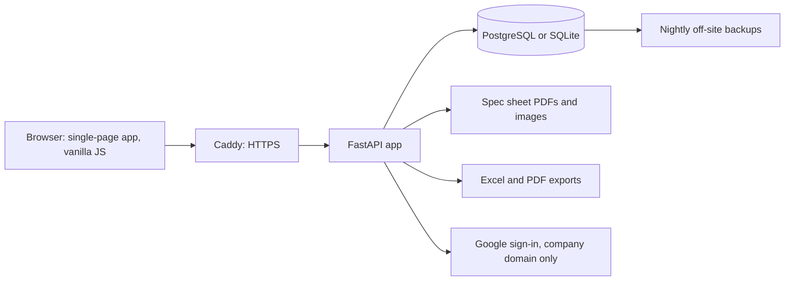

# Quotation Tool

A web app I built and shipped during my internship at a lighting design studio in Delhi
(Jul 2026 to present). It replaced the studio's manual quoting process and has been used daily by
its architectural and decorative lighting teams since September 2026.

This repository is a cleaned copy of the production code. The company and its in-house brand are
renamed ("the studio", "InHouse"), every product price and price list is removed, and client
documents, vendor PDFs, internal runbooks and the production database are left out.

## The problem

A lighting design studio answers each project with a BOQ (bill of quantities: every fixture, per
floor and per area) and then a priced quotation. Before this tool, that was done by hand in
spreadsheets. Mapping the workflow end to end showed four failure points:

1. **Spec sheets re-read for every project.** Manufacturer PDFs were opened and copied from each time.
2. **Configurations never checked.** Nothing stopped an impossible combination (a wattage with a
   beam angle that product does not come in).
3. **Prices kept apart from products.** Prices lived in separate sheets and drifted out of sync.
4. **Documents re-typed.** The final BOQ and quotation were rebuilt by hand in the studio's format.

## What it does

| Area | What it does |
|---|---|
| Product library | Upload manufacturer spec sheet PDFs; each page is parsed into a structured product (title block, parameter tables, pictures). |
| Configurator | Pick a product and its options; configuration rules hide combinations that do not exist. The rules were a 104 kB Google Apps Script; they are now data the team edits. |
| Product data (NPD) | Products, option lists, product codes built from editable structures, vendor order codes with how sure each one is. |
| BOQ builder | Floors, areas and items, or a quick BOQ; copy and move lines; find and jump in large BOQs. |
| Exports | Excel and PDF BOQs and quotations that match the studio's existing documents. |
| Excel import | Reads a BOQ that went out as Excel and came back edited, by column meaning rather than position, and links each line to a product or marks it "to check". |
| Requirement matching | Reads a client's requirement document and matches each fixture to products; an optional LLM fills only the fields the rules missed. |
| Access | Google sign-in restricted to the company domain (checked in code), two roles, one central permission check, an append-only activity log. |
| Phones and tablets | Every screen fits the device: same features, rearranged, no sideways scrolling. |

## Architecture



## Code map

| Path | What it is |
|---|---|
| `app/main.py` | Every route (about 10,000 lines), the central permission check `_required_permission`, the activity log |
| `app/models.py` | Every table (SQLAlchemy) |
| `app/pdf_parser.py` | Spec sheet PDF to structured product: title block and parameter tables, one page per product |
| `app/typology_classifier.py` | Keyword rules that guess a product's type, and leave it blank rather than guess wrong |
| `app/config_rules.py`, `app/configurator.py` | The configuration rules engine and which options are asked per brand and type |
| `app/product_codes.py`, `app/npd.py` | Product codes assembled from editable structures; the product data screens |
| `app/boq_import.py` | Excel BOQ import by column meaning |
| `app/requirement_reader.py`, `app/requirement_matcher.py`, `app/llm_extract.py` | Requirement documents: regex reader, matcher, and the add-only LLM fallback |
| `app/excel_export.py`, `app/quotation_export.py`, `app/pdf_export.py` | BOQ and quotation exports |
| `app/auth.py`, `app/google_auth.py` | PBKDF2 passwords and Google sign-in restricted to one domain |
| `static/app.js` | The whole front end (about 25,000 lines, vanilla JavaScript) |
| `scripts/migrations/` | 40 schema changes, each idempotent with `--dry-run` |
| `scripts/maintenance/gate.py` | The commit gate: compiles everything, checks doc links, counts brand-specific code |
| `.claude/agents/` | The Claude Code sub-agents used to plan, test, review and release changes |
| `docs/changes/` | A record per change: reason, evidence, acceptance checks, rollback |
| `docs/USER_GUIDE.md` | Every feature, from the user's side |

## Decisions worth explaining

* **A quote line copies its values when it is added.** Editing a product later cannot silently
  change a quotation that was already sent.
* **Rules are data, not code.** Configuration rules, code structures and driver data live in
  tables the team edits. The commit gate counts brand-specific `if` statements in shared code.
* **A heuristic may merge, never delete.** Automatic clean-ups can combine records but never remove
  what a person entered. Duplicate detection on upload is exact-match only.
* **The LLM is a fallback with a short leash.** Rules read known layouts. For what they cannot read,
  a model returns JSON; a line whose text is not in the source is dropped, the model may only pick a
  product from a shortlist the app gives it, and everything it touched is marked "to check".
* **Migrations are safe to re-run.** Each checks whether it was already applied, supports
  `--dry-run`, and prints what it did.

## How I worked

Built with Claude Code as a pair programmer, inside a process that does the checking: a change
record with acceptance checks before code, one change per branch, a pre-commit gate, custom
sub-agents for planning, feature testing against real endpoints, review and release, local testing
first, and production deploys approved change by change.

## Run it locally

```bash
pip install -r requirements.txt
set SESSION_SECRET=any-long-random-string          # PowerShell: $env:SESSION_SECRET="..."
python seed.py                                     # creates data/app.db (SQLite) on first run
python create_user.py                              # email, password, role (admin or member)
python -m uvicorn app.main:app --reload            # http://127.0.0.1:8000
```

Set `DATABASE_URL` to a PostgreSQL DSN to use Postgres instead; no code change is needed. Google
sign-in turns on when `GOOGLE_CLIENT_ID` and `GOOGLE_CLIENT_SECRET` are set (see
`GoogleAuthSetup.md`). The library starts empty: upload a manufacturer spec sheet PDF to begin.

## Not in this copy

Product prices and price lists, the studio's pricing rules, client documents and project names,
vendor spec sheet PDFs, the production database, internal reports and tutorial, and the server,
DNS and backup runbooks. Some docs still link to those files.
